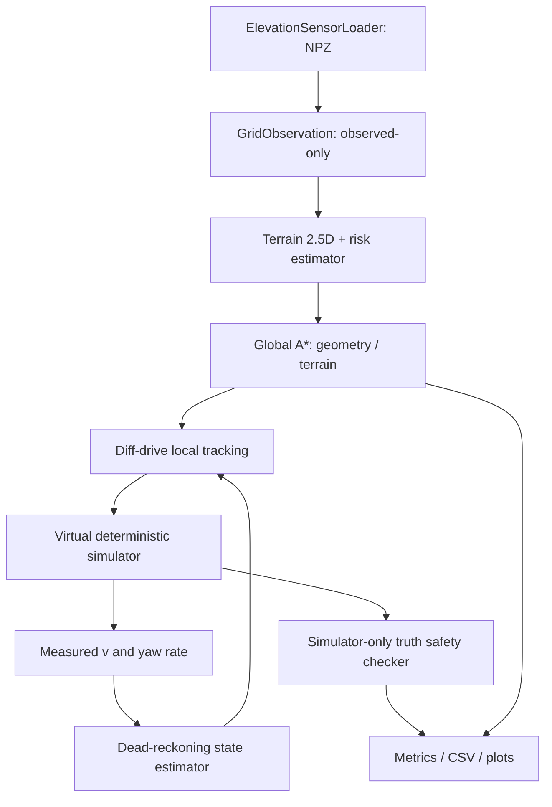

# 05 — Reproducible Terrain-Aware Planning Baseline for Wheeled UGVs

**Version:** 0.1.0 · **Experiment date:** 06/11/2026 (Asia/Bangkok) · **Research status:** **functional synthetic software baseline**, **NOT a reproduced Feng et al. (2025) experiment**, **NOT physical-terrain validated**. No meta-learning, JEPA, MoE or learning-based dynamics has been included.

> **Decision gate:** The deterministic software-scaffold gate is satisfied (16 tests passed, 50 simulated runs measured). The **research-grade physical/reproducibility gate is NOT satisfied** (no Gazebo/Chrono/ROS 2 execution, no measured wheel-slip dataset, no independent reproduction of the original paper, no external field tests). Do not move to the AI claims phase based on the synthetic table alone.

## 1. Literature basis, algorithm selection and original-paper audit

### 1.1 Source-grounded primary reference

**Chenlong Feng, Jixin Wang, Qi Wang, Yuying Shen, Yunda Wei, Shaokai Zhang, Shuyi Zhang, Quan Zhang (2025)**, *Constraint-aware motion planning for vehicles with terrain traversability assessment and optimization in construction scenarios*, *Advanced Engineering Informatics* 68, 103625, DOI **[10.1016/j.aei.2025.103625](https://doi.org/10.1016/j.aei.2025.103625)**. Source audited against the **24-page user-provided full-text PDF** `1-s2.0-S147403462500518X-main.pdf`, especially pp. 5–10 (method/algorithms), pp. 15–21 (experiments). Official [publisher page](https://www.sciencedirect.com/science/article/pii/S147403462500518X).

**Paper's actual pipeline** (Figure 2, PDF p. 5):

1. **VAF:** use vehicle-grade-related neighborhood geometry to filter true traversable point cloud (Eq. 1, Algorithm 1). Maximum climbing gradient `alpha` and noise relaxation `omega` are explicit, geometric parameters.
2. **TTA:** elevation patches with timestamp-aligned GPS and IMU. Target patch traversability is mean absolute pitch + roll (Eq. 2). The paper uses CNN + ConvLSTM with patches **32×32** and temporal context (pp. 6–8). The prose mentions a window of 10 while a displayed input tensor states T=5; this inconsistency requires checking source/author confirmation before exact reproduction.
3. **Patch-RRT\*:** randomly sample points, retrieve local elevation patches, use terrain cost, neighbor rewiring and goal-region search (Algorithm 2, PDF p. 10; an RRT\*-style algorithm, not A\*).
4. **Trajectory optimization:** segmented Bézier with objective integrating jerk magnitude squared plus terrain cost and segment-time cost (Eqs. 4–8, PDF p. 8); safe rectangular corridors, waypoint/continuity/speed/acceleration constraints (pp. 8–9); PHR-ALM with L-BFGS.
5. **Experiments:** simulation plus a real wheeled vehicle; PDF p. 15 describes VAF `alpha=0.8 rad`, `omega=0.16`, `Vmax=1.6 m/s`, `Amax=1.5 m/s²` for a simulation case. These values **are NOT copied into our synthetic differential-drive test rig** because operating conditions differ.
6. **Limits:** the paper's p. 22 Table 18 explicitly points to loose soil, muddy, highly deformable terrains as future extension of TTA, and later recommends online local replanning; the method is not yet a generally validated wheel–soil simulator.

**Author implementation status:** No verified, public, author-maintained executable repository and no complete reproducibility package has been established from the supplied paper or inspected authoritative materials. The code used here was **independently authored as a simplified baseline**. The absence of an identified author repository is **not a claim that one cannot exist**. Hence this is *methodological partial reconstruction / inspired-by*, not result reproduction.

### 1.2 Algorithm comparison and decisions

| Algorithm | Strength | Key issue for uneven wheeled UGV | Role in this phase | Real code/source |
|---|---|---|---|---|
| Geometry A\* | Simple, deterministic, easy optimality diagnostics for stated grid cost | Ignores slope/traction; does not directly enforce car-like curvature | **Implemented control baseline**, 8-connected | Our `planner.py`; Nav2 [Smac 2D](https://docs.nav2.org/rolling/configuration_and_development/configuration_guide/planners_plugins/smac/) |
| Terrain-weighted A\* | Same topology and controller; isolates effect of traversability costs and hard masks | Grid approximation; traction proxy not genuine wheel physics | **Implemented main classical baseline** | Our `planner.py` |
| D\* Lite | Incremental reuse of search after map changes | Requires truly dynamic observation/update protocol | Not implemented; planned future online replanning | [Koenig & Likhachev 2002](https://publications.ri.cmu.edu/d-lite) |
| Hybrid A\* | SE(2) heading, turn-radius feasibility; appropriate car-like/Ackermann | More complicated and platform-specific; must tune motion primitives | **Recommended next** if Ackermann platform selected | Nav2 [Smac Hybrid](https://docs.nav2.org/rolling/configuration_and_development/configuration_guide/planners_plugins/smac/) |
| State Lattice | Arbitrary valid motion primitives, including skid-steer-specific | Need calibrated primitives and footprint | Recommended for skid-steer transition | Nav2 [Smac Lattice](https://docs.nav2.org/rolling/configuration_and_development/configuration_guide/planners_plugins/smac/) |
| RRT\* / Informed RRT\* | Sampling-based, suitable for high-dimensional state space | Slower/variable sampling results; terrain validity and kinodynamic steering must be supplied | **Not implemented**; needed for faithful Feng comparison | OMPL library / Feng Algorithm 2 |
| MPC / MPPI | Constrained local trajectory optimization and receding-horizon feedback | Requires calibrated vehicle model/critics; computationally heavier | **Not implemented** | Nav2 [MPPI controller](https://docs.nav2.org/rolling/configuration_and_development/configuration_guide/controller_plugins/mppi_controller/configuring_mppic/) |
| Rotate-then-drive local tracking | Auditable differential-drive kinematics, bounded `v,w,a` | Stops to turn; poor for real skid-steer soft soil; no optimal control | **Implemented** local controller | Our `local.py` |

**Selected research-scaffold platform:** ideal **differential-drive** wheeled UGV (body commands `v,w`; in-place rotation permitted). This should **not be labeled Ackermann or physically accurate 4WD skid-steer**. Although Phase 03 contemplates a skid-steer primary physical robot, that bridge remains unimplemented and is a blocker for future platform claims. Current 2D A\* path is realizable by ideal rotate-in-place differential drive but not by a vehicle constrained to nonzero turning radius.

## 2. Architecture and interfaces



This is a simplified desktop test harness. `GridObservation` replaces non-observed elevation with placeholders and masks; terrain-based planning marks unknown blocked. It does not acquire RGB, LiDAR, raw IMU or ROS bags. Truth terrain is used only for simulator integration and **post-hoc safety evaluation**. The state estimator receives generated wheel/IMU-like measurements, not true XY at every iteration; current noise is zero, so this is still optimistic. The safety checker has oracle access to the true terrain: deliberately an offline evaluation supervisor, **not deployable as-is in unknown environments**.

**Modules:**

```text
terrain_ugv_baseline/
├── configs/benchmark.yaml             # fixed seeds and model parameters
├── terrain_baseline/
│   ├── model.py                       # typed 2.5D map, robot, risk tensor
│   ├── sensors.py                     # .npz loader + observation mask
│   ├── scenarios.py                   # five synthetic test worlds
│   ├── terrain.py                     # slope, roughness, traction/slip proxy
│   ├── planner.py                     # two 8-neighbor A* variants
│   ├── estimation.py                  # wheel/yaw-rate odometry estimator
│   ├── local.py                       # local tracking + sim adapter
│   ├── safety.py                      # simulator-truth supervisory checker
│   ├── experiments.py                 # paired trials, CSV, manifest
│   ├── visual.py                      # terrain/path/trajectory overlays
│   └── cli.py                         # command line entrypoint
├── tests/test_core.py                 # repeatability, masking, safety, I/O
├── results/                          # measured artifacts generated on run
├── requirements.txt
├── pyproject.toml
└── README.md
```

### 2.1 Mathematical specification of the implemented baseline

Grid cell center `q=(i,j)` has position `(x,y)=(jΔ,iΔ)`, `Δ=0.38m`. Estimated gradient uses an observed-only filled elevation map, roughness is high-frequency residual RMS after local smoothing, and risk is the **synthetic heuristic**

\[
\hat s(q)=\mathrm{clip}\!\left(0.04+0.63[1-\hat\mu(q)]+0.12\min(\hat\rho(q)/0.10,1),0,1\right).
\]

Here `mu` is a *nominal synthetic traction scalar*, **not** identified friction and `s` is a *risk proxy*, **not measured physical wheel slip**. This functional form is a test fixture, not derived from Feng et al. (2025). Under the terrain planner, candidate cells are rejected for `slope>17°`, `roughness>0.10m`, `slip_proxy>0.56`, obstacle, or unknown. A conservative clearance margin is applied by grid dilation, but it is not a verified tracking-error bound.

For 8-connected edges `p→q`:

\[
 c_{\rm geom}(p,q)=\Delta\sqrt{(\Delta i)^2+(\Delta j)^2},\quad
 c_{\rm terrain}(p,q)=c_{\rm geom}(p,q)\!\left[1+2\frac{\bar\theta_{pq}}{0.30}+1.5\frac{\bar\rho_{pq}}{0.10}+2.5\bar s_{pq}\right].
\]

The Euclidean lower-bound heuristic is admissible for both modes since the edge multiplier is ≥1. The algorithm forbids diagonal corner cutting across blocked cells. A\* is globally optimal **only for the discretized, fixed cost graph** and does not imply continuous 3D trajectory optimality.

Virtual robot tracks the generated waypoints with ideal differential-drive limited body twist; the simulator reduces forward speed as a function of traction. Before executing each step, the oracle supervisor checks interpolated footprint samples against the true synthetic map; unsafe proposals are stopped, **not executed**.

**Important distinction:** The geometry planner is not evaluated against a less restrictive safety supervisor: **both planners use the identical oracle checker**. An accepted path and a successful mission are separately counted. A terrain planner that reroutes around a declared synthetic hazard is not evidence of higher safety on real terrain because both planner and checker use largely the same synthetic hazard equations.

## 3. Reproducible installation and execution

Environment used for test: Linux x86_64, Python with NumPy/SciPy/Matplotlib/PyYAML/pytest. No ROS 2 or Gazebo system integration was run. General Fedora 44 commands:

```bash
unzip terrain_ugv_baseline.zip
cd terrain_ugv_baseline
python3 -m venv .venv
source .venv/bin/activate
python -m pip install -U pip
python -m pip install -e . pytest
pytest -q
python -m terrain_baseline.cli --config configs/benchmark.yaml --output results
```

Alternative no editable install: `PYTHONPATH=. python -m terrain_baseline.cli ...`. The command creates `results/metrics_raw.csv`, `results/metrics_summary.csv`, `results/MEASURED_RESULTS.md`, `results/run_manifest.json`, one PNG per scene, and path/trajectory CSV files per scenario for the first seed. Manifest captures Python version, platform, dependencies and exact run configuration. To compare path and outcomes across runs, ignore **wall-clock latency** which naturally varies with CPU load; choose `seed` and `scenario` from the fixed YAML. For publication, also save commit SHA, package hashes, hardware/CPU details and raw input dataset checksums.

**Tests:** Grid shape and bounds, sensor round-trip, masked hidden data, unknown avoidance, A\* diagonal-corner exclusion, 5-case deterministic rerun, path truth-safety check, shared supervisor stop, odometry update. Integration uses the same `execute()` entrypoint as the CLI. Total: **16 passed** in this environment.

## 4. Experiment protocol and synthetic results — measured, not predicted

`scenarios=['flat','slope','rough','hazard','unknown']`; `seeds=[42,43,44,45,46]`; `planners=['geometry','terrain']`; **50 runs** (5 synthetic seeds per planner per scene). Same 45×47 map geometry / 0.38m cells, fixed start `(row22,col4)` and goal `(row22,col42)`, shared robot and controller, shared oracle supervisor. Seeds change low-amplitude synthetic height noise and rough patch. **These seeds are not 5 distinct real-world trials**; categories and dangerous zones are deliberately hand-designed.

| Scenario | Geometry A\* success (n=5) | Terrain A\* success (n=5) | Geometry unsafe global proposals | Terrain unsafe proposals | Terrain median global planning (ms) | Terrain mean global path (m) |
|---|---:|---:|---:|---:|---:|---:|
| Flat | 5/5 | 5/5 | 0/5 | 0/5 | 14.56 | 14.44 |
| Slope | 0/5 | 5/5 | 5/5 | 0/5 | 35.51 | 20.41 |
| Rough | 0/5 | 5/5 | 5/5 | 0/5 | 21.50 | 17.27 |
| Hazard / low traction | 0/5 | 5/5 | 5/5 | 0/5 | 20.05 | 16.96 |
| Partially observed | 0/5 | 5/5 | 5/5 | 0/5 | 19.60 | 18.26 |

The geometry planner's median planning times were ~0.43–0.77ms per scene in this run. **Observed total successes:** geometry **5/25 = 20%**, terrain **25/25 = 100%**, **solely on these engineered synthetic maps**. Terrain-aware planner takes a longer global route in all four hazard cases. Global planning latency numbers are **single-run, platform-specific descriptive values**, not benchmarked embedded-system latency, and must not be directly compared to Feng's reported `time cost`.

Detailed CSV reports also include executed trajectory length, travel time, tracking RMSE, expanded nodes, stop reasons and supervisor intervention rate; trajectory CSVs and plot overlays are included. `executed_constraint_violations` is zero by construction because an oracle supervisor intercepts the motion; **do not present 0 as independent safety evidence**. `unsafe_plan` evaluates any global-path segment against true synthetic terrain; it is an offline planning diagnostic, not a deployed runtime sensor.

## 5. Reproduction ledger — original vs implemented vs status

| Element | Feng et al. (2025) — source claim | Current code (Nov 2026) | Reproduction status |
|---|---|---|---|
| 3D input / mapping | Point clouds; VAF geometric filter; elevation patches | Synthetic elevation grid + known/unknown flags; no point-cloud VAF | **Not reproduced** |
| Terrain cost | CNN + ConvLSTM TTA trained from IMU pitch/roll + elevation sequences | Deterministic slope, roughness and low-traction risk proxy | **Not reproduced** |
| Search | Patch-RRT\* sampling with on-demand patch evaluation and rewiring | 8-neighbor A\* with a priori cost grid | **Different algorithm** |
| Optimization | Bézier segments, minimum jerk, hard corridor & dynamics, PHR-ALM + L-BFGS | Rotate/drive waypoint tracking with bounded `v,w,a` | **Not reproduced** |
| Simulator | Paper reports Blender/Gazebo and real wheeled robot conditions | Python synthetic kinematic engine | **Different simulator** |
| Test cases | Real construction / forest trials | 5 synthetic, hand-designed terrains | **Not comparable** |
| Original comparative real-world row (Table 17 p.21) | **10.028 s; 24.248 m; mean speed 1.023 m/s; mean acceleration 0.274 m/s²; max abs pose 10.430°, mean abs pose 4.029°, time cost 25.634 ms** | Synthetic metrics above on different map/robot/problem | **DO NOT compare numerically** |
| Author code / weights / dataset | Not independently located as verified public release | Independent open and runnable code package supplied | **Missing original artifacts** |
| Reproducibility | Metrics published but original run inputs not in current workspace | Config, seeds, logs, tests, plots, CLI + manifest | **Local synthetic reproducibility achieved** |

**Next faithful reproduction requirements:** obtain authors' implementation/config/weights or independently reproduce Eq. 1 / Algorithms 1–2 / TTA training per patches / Bézier corridor objective under actual input point clouds, match original vehicle geometry, controller, start/goal, physical parameters, test scenarios and timing measurement methodology. Until then, a cross-paper improvement percentage is invalid.

## 6. Limitations, risks and scientific interpretation

- **Risk proxy leakage / circular benchmark:** Synthetic danger is defined in terms of traction, geometry, and the same heuristic used by terrain-A\* and truth-checker. It demonstrates expected functionality, *not* generalization or independently measured safety. Must add independent vehicle dynamics and hidden material properties in external simulation / real data.
- **No force-based slip, lateral slip, sinkage, deformable soils, uncertainty calibration, or energy/pose stability ground truth**. Rotation-on-the-spot is ideal; on real soft terrain skid-steer turning can induce large soil shear and slip.
- **No physical pitch/roll or wheel–ground clearance** in simulation. Terrain slope constraint is a scalar geometric heuristic, not measured center-of-mass stability.
- **No VIO/GNSS fusion** or uncertain pose tracking; odometry is ideal/noiseless. Consequently RMSE results are not representative of a field robot.
- **No real sensors / Nav2 / Gazebo / Chrono executed.** Sensor loader uses `.npz` grid snapshots. Integration plan must publish costmap + path and consume odometry and transforms with ROS 2 nodes before claiming ROS 2 deployment.
- **No online replanning or dynamic terrain update**. Unknown cells are fully blocked in terrain mode; some scenes might become infeasible, motivating map exploration policies and a safety-state decision separate from global planning.
- **No model learning**. The current baseline cannot support conclusions about negative transfer, few-shot support sets, JEPA, MoE or unseen terrain dynamics.
- **Computational cost not constrained/benchmarked on edge device**. Container timings include Python overhead. Need fixed hardware, repeated trials, percentiles and CPU/GPU usage measured.
- **Small, hand-designed sample:** five seeds change minor noise, not independent domain shift. This table must not be submitted as statistical evidence for Q1.

## 7. Conditions before proceeding to the learning stage

**Software regression gate (PASS)**

- [x] Independent executable Python environment with pinned *ranges* of dependencies; configuration written to disk.
- [x] Shared controller, safety supervisor and vehicle constraints for both planners.
- [x] Unit/integration tests (**16/16**) and 50 measured synthetic trials.
- [x] Measured CSV, reproducible seeds, trajectory CSV, map/path overlay figures.
- [x] Reproduction ledger prevents misrepresentation of Feng results.

**Research validity / reproduction gate (NOT PASS)**

- [ ] Pin exact versions in a lock file and record source commit SHA + package hashes.
- [ ] Reproduce on >=2 machines or isolated containers with invariant path/decision outputs.
- [ ] Integrate ROS 2 (specific distro selected for installed OS), Nav2 planner/controller + state estimator and ROS bag data.
- [ ] Validate a physically faithful skid-steer/Ackermann dynamics model as appropriate; run Gazebo wheel-slip and independent Chrono soil tests.
- [ ] Replace slip proxy with experimentally measurable slip definition (wheel speed vs ground speed), report IMU roll/pitch and physically meaningful failure thresholds.
- [ ] Pre-register matched baseline experiments, terrain splits, no data leakage, external held-out terrains and sufficient paired runs for intervals.
- [ ] Acquire/implement original Feng setup sufficiently to report legitimate reproduction numbers **or** explicitly target a different public, reproducible wheeled-UGV classical baseline.
- [ ] Demonstrate no robot safety violation under a **non-oracle** deployable risk estimator; implement safe-stop/unknown behavior and record both false-stop and missed hazards.

**Stage decision:** phase 05 delivers an **auditable and executable baseline prototype**. It is suitable for **software regression and building the physics-based/ROS baseline**, but **not yet a trustworthy Q1 experiment baseline for claims about learned terrain generalization**. Do not start comparative AI claims until the second gate passes.

## 8. Source register

- Feng et al. (2025), *Advanced Engineering Informatics*, DOI [10.1016/j.aei.2025.103625](https://doi.org/10.1016/j.aei.2025.103625). Primary evidence: user-provided original PDF, pp. 5–10 and 15–22.
- Nav2 Smac Planner: https://docs.nav2.org/rolling/configuration_and_development/configuration_guide/planners_plugins/smac/
- Nav2 MPPI: https://docs.nav2.org/rolling/configuration_and_development/configuration_guide/controller_plugins/mppi_controller/configuring_mppic/
- D\* Lite original record: https://publications.ri.cmu.edu/d-lite
- Stage 03 formulation and Stage 04 benchmark (local documents) establish the research-level safety/data-efficiency requirements that this first executable scaffold has **not yet met**.
