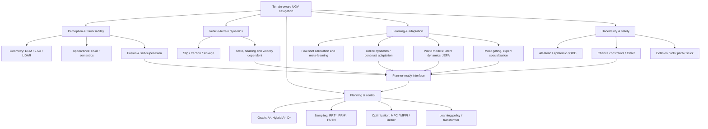

# 01 — Systematic Literature Review: Terrain-Aware Path Planning for Wheeled UGVs

> **Đóng băng tài liệu:** 05/11/2026 (Asia/Bangkok). **Mục đích:** scoping/systematic-style review phục vụ hình thành nghiên cứu về terrain-aware path planning cho **wheeled UGV**. **Không** đề xuất kiến trúc cuối cùng. Các giả thuyết nghiên cứu chưa phải là kết quả thực nghiệm.
>
> **Mức kiểm chứng:** P = đọc toàn văn PDF do người dùng cung cấp; W = đối chiếu bài gốc / trang nhà xuất bản / kỷ yếu / hồ sơ nhóm nghiên cứu; A = chỉ xác nhận nguồn nền tảng hoặc preprint. Chữ **KX** = chưa xác minh độc lập thông số cần thiết, *không* có nghĩa công trình không thực hiện nội dung đó.

## Executive abstract

Đã sàng lọc **9 PDF**: 8 liên quan tới lĩnh vực robot (7 công trình/survey về ground-vehicle hoặc unstructured environment và 1 bài quadruped chỉ làm đối chiếu) và **1 PDF loại do ngoài phạm vi** (`21463663-4679-4410-9410-7e3bfada60ed_1.pdf`, đề Toán lớp 9). Thư mục mở rộng lập được **48 bản ghi** có thể tra cứu nguồn: **29 công trình trực tiếp** (A), **13 công trình/dữ liệu nền hỗ trợ** (B), **3 survey** (S) và **3 đối chiếu ngoài wheeled UGV** (C). Vì đây chưa phải thống kê truy hồi đầy đủ từ tài khoản Web of Science/Scopus, **không được tuyên bố đã đạt chuẩn PRISMA 2020 đầy đủ, không khẳng định tất cả bản ghi thuộc SCIE, và không xác nhận Q1 của bất kỳ tạp chí nào chỉ từ tên tạp chí**.

**Quan sát quan trọng:** Ba hướng được quan tâm đều đã có công trình gần bài toán: **METAVerse (IROS 2024), MAGIC-VFM (T-RO 2025), Levy et al. (RSS 2025)** về thích nghi / meta-learning; **NavMoE (ICRA 2026)** về MoE cho traversability/local navigation; **TerrainFormer (Sensors 2026)** về world model và action prediction off-road. **V-JEPA 2** có minh chứng planning trên tay máy Franka, không phải xe UGV off-road. Do đó không thể nêu đơn giản rằng “chưa ai kết hợp AI + planning / meta-learning / MoE ở địa hình”.

Một khác biệt về bằng chứng phải được giữ xuyên suốt: **perception IoU/F1/accuracy ≠ planning success rate**; **action-classification accuracy ≠ closed-loop navigation success**; **dynamics prediction error ≠ path safety**. Phải kiểm tra luồng chứng cứ từ sensor → terrain representation → planner → điều khiển → thực thi.

## 1. Protocol tìm kiếm, giới hạn kiểm chứng và tiêu chí sàng lọc

### 1.1 Câu hỏi của literature review

- *Population*: wheeled UGV / off-road wheeled mobile robot, bao gồm skid-steer, Ackermann, differential-drive, ATV; tracked, legged và wheel-legged chỉ dùng làm transfer/contrast nếu có lý do kỹ thuật.
- *Intervention*: hình học/semantic/terramechanics, state-/velocity-dependent traversability; graph/sampling/optimization/learning-based planning; adaptation, world model, JEPA, MoE, uncertainty/safety.
- *Comparator*: A*/Hybrid A*/D*; RRT*/Informed-RRT*/PUTN; MPC/MPPI; deterministic vs uncertainty-aware traversability; static vs online adapted dynamics; monolithic vs modular/MoE.
- *Outcomes*: completion/success rate, collision/rollover/stuck/slip events, path length, traversal time, tracking error, terrain cost/risk, energy/comfort, planning latency, online adaptation speed, calibration, cross-terrain transfer.

### 1.2 Search strings có thể tái chạy

```text
("wheeled robot" OR "ground vehicle" OR UGV OR "off-road driving")
 AND ("terrain-aware" OR traversability OR "vehicle-terrain" OR terramechanics)
 AND ("path planning" OR "trajectory optimization" OR MPC OR MPPI OR "motion planning")

("off-road" OR "unstructured terrain")
 AND ("meta-learning" OR "few-shot" OR "online adaptation" OR "self-supervised")
 AND (traversability OR dynamics OR navigation)

("world model" OR "JEPA" OR "latent planning" OR "predictive model")
 AND (robotics OR navigation OR "off-road")

("mixture of experts" OR MoE OR "conditional experts")
 AND (terrain OR traversability OR robot navigation)

("risk-aware" OR "uncertainty-aware" OR CVaR OR OOD)
 AND ("terrain" OR "off-road") AND (navigation OR planning)
```

**Thực hiện trong phiên này:** đọc toàn văn PDF đã cấp; tra cứu công khai qua trang publisher (IEEE/Wiley/Springer/Elsevier/MDPI), RSS/PMLR/ICLR/CVPR, arXiv, cơ sở thư mục DBLP và nhóm nghiên cứu; kiểm tra *một số* URL GitHub. **Chưa thực hiện** xuất bản ghi có log số hit/dedup từ các tài khoản WoS Core Collection, Scopus và Google Scholar; chưa có 2 reviewer độc lập hoặc risk-of-bias assessment. Vì vậy tiêu đề là *review có tính hệ thống và truy xuất nguồn*, chưa phải một SLR hoàn tất theo PRISMA.

### 1.3 Bộ quy tắc inclusion/exclusion

| Mã | Quy tắc | Quyết định |
|---|---|---|
| IN-1 | Wheeled robot trên địa hình tự nhiên/không cấu trúc; đánh giá traversability → path/trajectory/navigation | A — trực tiếp |
| IN-2 | Meta-adaptation / vehicle–terrain dynamics / MoE / world-model có đánh giá đường đi, control hoặc safety liên quan | A — trực tiếp hoặc cầu nối có ghi rõ |
| IN-3 | Survey, dataset, kỹ thuật JEPA/world model tổng quát nhưng thiết yếu để so sánh phương pháp | S/B — nền tảng, **không** dùng để xác nhận kết quả wheeled path planning |
| EX-1 | Legged/humanoid/wheel-legged không có thử nghiệm wheeled UGV | C — chỉ đối chiếu |
| EX-2 | Perception-only không có planning | Có thể giữ B/A (tầng input), nhưng phải ghi không có planning metrics |
| EX-3 | Nội dung không về robotics | Loại |
| EX-4 | Repository, DOI, số liệu chưa xác nhận | Không điền suy đoán; đánh dấu KX |

## 2. Close reading: 8 PDF gốc

### P1. Papadakis (2013) — nền tảng traversability

- **Nguồn:** *Engineering Applications of Artificial Intelligence*, DOI `10.1016/j.engappai.2013.01.006`, PDF `survey.pdf`, tr. 1–13.
- **Đọc hình:** Hình 1, tr. 3, chia sensory pathway thành **proprioception** và **exteroception**, rồi tách appearance và geometry; Hình 2 phân tích sự giao giữa *terrain model*, *robot model*, *stability*, *kinematic constraints*. Bảng 1, tr. 4, cho thấy ngay các nghiên cứu cũ đã khác nhau về việc có tính robot/stability/kinematics hay không.
- **Bằng chứng:** traversability được định nghĩa phụ thuộc mô hình terrain, robot và ràng buộc, không chỉ là màu sắc, độ dốc hay loại bề mặt. Bài review không phải bộ benchmark trực tiếp và không đánh giá few-shot/JEPA/MoE (ra đời sau).
- **Hàm ý:** đừng đồng nhất terrain classification với feasible motion của một xe cụ thể.

### P2. Arafin et al. (2025) — survey perception

- **Nguồn:** *Journal of Field Robotics* 42:3515–3544, DOI `10.1002/rob.22586`, tr. 1–30.
- **Đọc hình:** Flowchart literature methodology tr. 4 mô tả database search → selection → taxonomy; Bảng 1 tr. 3 so sánh mức phủ các survey. Tác giả phân chia appearance/geometry/hybrid và dữ liệu off-road.
- **Bằng chứng:** P1 được tác giả xếp vào traversability review cũ; perception metrics có accuracy/IoU/F1, bên cạnh khả năng hỗ trợ navigation thực tế. Chính tác giả phân biệt chức năng perception và planning.
- **Giới hạn đối với đề tài:** không được lấy mức IoU của một classifier trong survey thay cho an toàn, quãng đường hay thời gian UGV.

### P3. Ge et al. (2026) — coupling perception ↔ planning

- **Nguồn:** *Machines* 14:713, DOI `10.3390/machines14070713`, 54 trang.
- **Đọc hình:** Hình 2 tr. 5 trình bày *traversability-driven coupling framework*. Bảng 1 tr. 4 đặt các survey bên cạnh nhau; các chương tiếp so sánh modular / tightly-coupled / end-to-end, rủi ro, datasets và metrics.
- **Bằng chứng:** traversability cần được chuyển thành **costs / constraint boundaries / risk distributions / feedback** có tác động đến planner. Tác giả đề xuất khung adaptive-coupling mang tính *review/future directions*, không báo cáo benchmark một planner mới.
- **Giới hạn:** luận điểm “coupling yếu” là nhận định tổng hợp của tác giả, chưa phải xác minh thực nghiệm rằng mọi hệ thống đều yếu.

### P4. Beycimen et al. — fusion terrain map

- **Nguồn:** accepted 27/09/2025, bản xuất bản *JFR* **2026** 43:1719–1738, DOI `10.1002/rob.70097` (khác năm trong tên file).
- **Đọc hình:** mô tả kết hợp appearance semantic segmentation (13 lớp), geometric stereo depth, projecting classes lên 2.5D map; sử dụng ba ZED-2, giới thiệu **CranfieldTerra**. Các bảng ở nửa sau tài liệu đánh giá theo lớp và sai số hình học.
- **Bằng chứng:** làm mạnh tầng perception/mapping, không có một benchmark path-planning độc lập đủ để đồng nhất kết quả fusion với navigation success.
- **Giới hạn:** phụ thuộc chất lượng ảnh/depth, đồng bộ cảm biến và loại môi trường; dữ liệu được công bố “available from corresponding author upon reasonable request”, **không** được giả định đã có public download.

### P5. Lee & Lee — URF thích nghi online

- **Nguồn:** chấp nhận 21/07/2024; *JFR* **2025** 42:287–301, DOI `10.1002/rob.22411`.
- **Đọc hình:** Hình 1, tr. 3, biểu diễn PSPNet50 → softmax/terrain-cost image kết hợp nhánh **adaptive uncertainty rejection filter (URF)**; ảnh bị thêm adversarial noise tạo bản đồ vùng không chắc chắn, được trộn vào map cho planning. Không update weights của PSPNet50 khi triển khai.
- **Bằng chứng:** robot dùng **10 ảnh** tại môi trường mới để đặt tỷ lệ bất định mục tiêu; thử nghiệm mô phỏng và vật lý 10 lần mỗi cấu hình, so URF adaptive / nonadaptive / no-URF. Chỉ số *planning/tracking* là **Hausdorff distance** giữa desired và actual trajectories. Bảng 4 của PDF báo cáo mean Hausdorff distance các cấu hình (phải giữ cùng đơn vị m; không so với mIoU).
- **Giới hạn:** **“10 ảnh để hiệu chỉnh ngưỡng” không đồng nghĩa “few-shot meta-learning”**. Là baseline rất sát vì có adaptation bằng ít quan sát và trực tiếp đo trajectory.

### P6. Feng et al. (2025) — wheeled dynamics-constrained planning

- **Nguồn:** *Advanced Engineering Informatics* 68:103625, DOI `10.1016/j.aei.2025.103625`, PDF 24 tr.
- **Đọc hình/chuỗi thuật toán:** map/valid area → IMU-informed continuous TTA (2D ConvLSTM + point cloud) → **Patch-RRT\*** → Bézier trajectory optimization với safety, waypoints, continuity, dynamic constraints. Bảng 1 tr. 3 phân loại graph / sampling / optimization / learning; phần Methods và Experiments có thử nghiệm mô phỏng và thực tế.
- **Bằng chứng:** liên kết thực sự từ terrain/robot dynamics đến đường đi thực thi được; ở đánh giá TTA tác giả báo R² = **0.980** và MAE = **0.028 rad** trên tập test mô phỏng, đây là metric *TTA model* chứ **không** là path success.
- **Limitations tác giả thừa nhận (Conclusion):** chưa xử lý **dynamic obstacles**, bỏ qua **unknown areas of map**; mô hình chủ yếu phù hợp trường hợp body phản ánh terrain contact, chưa được xác thực tương đương cho bùn/cát mềm có biến dạng rõ. Không tự coi những vấn đề này là hoàn toàn chưa ai giải quyết.

### P7. Santo et al. (2026) — TE-NeXt

- **Nguồn:** *EAAI* 175:114595, DOI `10.1016/j.engappai.2026.114595`.
- **Đọc hình:** Hình 1 tr. 4 là sparse 3D U-Net-like encoder/decoder, ConvNeXt-inspired 7×7×7 sparse residual blocks trên LiDAR point clouds; phần cuối kiểm tra navigation trong môi trường thực.
- **Bằng chứng:** Abstract báo **F1 82% trên RELLIS-3D** (perception), so trên SemanticKITTI và SemanticUSL; có thử nghiệm navigation và bảng tỷ lệ waypoint/planner success ở phần cuối. Code chính thức: [`ARVCUMH/te-next`](https://github.com/ARVCUMH/te-next).
- **Giới hạn:** point-wise traversability không trực tiếp nắm toàn bộ slip/traction; kết quả segmentation và waypoint success là hai phép đo khác nhau, không suy ra domain adaptation trên terrain chưa gặp chỉ từ tổng F1.

### P8. Yousefi et al. (2026) — quadruped contrast, không trộn benchmark

- **Nguồn:** *Intelligent Service Robotics* 19:34, DOI `10.1007/s11370-026-00696-4`.
- **Đọc hình/phương pháp:** 2.5D elevation map; sampling node kèm cặp opposite headings, lọc pitch/roll trong node & motion validity của adapted **LazyPRM\***. Tác giả báo **96 simulation trials và 60 real-world experiments** với Spot (tr. 2).
- **Giới hạn:** chưa online global replanning khi map thay đổi; quasi-uniform slope gần waypoint; **không thể dùng số liệu Spot để xác minh hiệu quả cho xe bánh**. Code: [`aliy98/slope_constrained_planner`](https://github.com/aliy98/slope_constrained_planner).

## 3. Taxonomy theo khía cạnh khoa học và interface của planner



**Taxonomy độc lập 4 trục**, không nên gộp thành một nhãn “deep-learning planner”:

| Trục | Lớp | Câu hỏi chứng cứ bắt buộc | Ví dụ trong thư mục |
|---|---|---|---|
| Information | RGB/semantic, LiDAR/geometry, multimodal, proprioception | Dữ liệu về **bề mặt** hay về **kết quả xe chạy trên bề mặt**? | Arafin, Beycimen, TE-NeXt, WVN |
| Traversability representation | Binary, continuous scalar, distribution, direction/state/velocity-conditioned | Có gắn với wheel clearance, traction, state và hành động không? | Papadakis, EVORA, SPARTA, Feng |
| Planner | Graph, sampling, optimization, learning, hybrid | Bản đồ cost/risk làm thay đổi đường đi hay chỉ segmentation? | PUTN, Feng, Lee, TRAIL |
| Adaptation | None, threshold-calibration, last-layer, gradient meta-learning, Bayesian/Kalman, expert gating, latent world-model | Khi đến terrain mới, cái gì **thực sự thay đổi** và với bao nhiêu observations? | Lee, METAVerse, Levy, MAGIC, NavMoE, TerrainFormer |

## 4. Bảng so sánh chuyên sâu — 20 nghiên cứu trọng tâm

**Quy ước:** “KX” = không xác minh được mức chi tiết bằng nguồn đã đọc trong phiên. **R1–R20** liên kết giữa hai bảng; không được tự chuyển metric perception hoặc policy imitation thành planning metric. Năm là năm **ấn phẩm bibliographic** khi biết, không nhất thiết là năm early-online.

### 4A. Metadata, vehicle, sensor, method, data

| ID | Nghiên cứu / năm / DOI | Vehicle / sensor | Thuật toán / đầu vào planner | Data / validation |
|---|---|---|---|---|
| R1 | **Feng 2025** `10.1016/j.aei.2025.103625` | Wheeled construction vehicle; point cloud + IMU/RTK | 2D ConvLSTM TTA → Patch-RRT* → Bézier constrained trajectory | Simulation + vehicle real-world |
| R2 | **Lee & Lee 2025** `10.1002/rob.22411` | Wheeled mobile robot; RGB + depth | PSPNet50 + online URF, terrain cost → planning | RUGD + sim + physical (10 runs/condition) |
| R3 | **Santo 2026** `10.1016/j.engappai.2026.114595` | Ground mobile robot; 3D LiDAR | TE-NeXt binary traversability → navigation framework | RELLIS-3D, SemanticKITTI, SemanticUSL + real navigation |
| R4 | **Beycimen 2026** `10.1002/rob.70097` | Robot platform; three ZED-2 + LiDAR/IMU | Semantic + geometry → 2.5D fused traversability map | CranfieldTerra; validation mainly mapping/perception |
| R5 | **Seo et al. 2024** `10.1109/IROS58592.2024.10802444` | Off-road ground vehicle; LiDAR + vehicle feedback | METAVerse self-supervised meta-learned continuous cost → MPC | Multiple terrains, real driving + navigation reported |
| R6 | **Levy et al. 2025** `10.15607/RSS.2025.XXI.139` | Full-scale off-road vehicle; state, IMU, controls, terrain | Offline meta-learn bases + online Kalman last-layer dynamics → MPPI | Off-road real vehicle + simulation |
| R7 | **Lupu et al. 2025** `10.1109/TRO.2024.3475212` | Tracked + car-like wheeled; RGB/VFM, state | MAGIC-VFM meta-trained residual dynamics + adaptive control | Field slopes / slip / actuator disturbance; physical + sim |
| R8 | **He et al. 2026** `10.1109/ICRA57385.2026.11696902` | Ground navigation (specific wheeled platform KX); semantic + geometric experts | NavMoE: gated terrain-specialized classical/learned experts → local navigation | Multi-domain experiments in paper |
| R9 | **Yang & Ricks 2026** `10.3390/s26123795` | Warthog, OS1-64 LiDAR logs | TerrainFormer: BEV PointPillars/ViT world representation + decision transformer | RELLIS-3D logs; **open-loop** action replay |
| R10 | **Cai et al. 2024** `10.1109/TRO.2024.3431828` | Wheeled + quadruped; vehicle feedback, terrain | EVORA: evidential traction, aleatoric/epistemic uncertainty → risk-aware rollout | Simulation + physical vehicles |
| R11 | **Dong et al. 2025** [PMLR](https://proceedings.mlr.press/v305/dong25a.html) | Wheeled / off-road robot; dense point cloud | SPARTA: Fourier heading-conditioned risk → planner | CoRL; 40 m boulder field sim + hardware |
| R12 | **Triest et al. 2025** [PMLR](https://proceedings.mlr.press/v270/triest25a.html) | Off-road vehicle; camera + LiDAR + motion | Velociraptor visual foundation features, self-supervised cost/speed/uncertainty | Field data / robot navigation, CoRL |
| R13 | **Mattamala et al. 2025** `10.1007/s10514-025-10202-x` | ANYmal/Jackal integrations; RGB + proprioception | Wild Visual Navigation: pretrained visual embeddings + online self-supervised traversability | Diverse field deployments, forests/grasslands |
| R14 | **Jian et al. 2022** `10.1109/IROS47612.2022.9981038` | Ground robot; 3D point cloud | PUTN: plane fitting RRT* → GPR → NMPC | Field experiments; IROS |
| R15 | **Jia et al. 2026** `10.1109/LRA.2026.3685928` | Off-road wheeled robot; terrain/robot observations | TRAIL implicit neural continuous terrain representation → gradient trajectory/speed optimization | IEEE RA-L; data & hardware detail KX |
| R16 | **Cai et al. 2023** `10.1109/IROS55552.2023.10341350` | Off-road robot; self-supervised terrain/traction | Probabilistic traction + CVaR/worst-case + density-based OOD penalties | Simulation, novel-domain benchmark |
| R17 | **Leininger et al. 2024** `10.1109/ICRA57147.2024.10610106` | Ground robot; local point cloud | Sparse GP (height/slope/uncertainty) → RRT* | Sim; compared with PUTN |
| R18 | **Yu et al. 2025** `10.1109/TITS.2024.3520520` | Full-scale off-road wheeled; UKF/terrain state | Terramechanics-adaptive MPC (sinkage exponent online) | Randomized sim + physical vehicle |
| R19 | **Datar et al. 2025** `10.1109/LRA.2024.3520919` | Wheeled platform with suspension/deformation | Data-driven vehicle–terrain modeling + planning | Terrain with large vertical obstacles |
| R20 | **Guan et al. 2022** `10.1109/LRA.2022.3187278` | Clearpath Jackal/Husky; RGB | GA-Nav navigability segmentation + DRL-based navigation | RUGD, RELLIS-3D + real robot |

### 4B. Baselines, outcomes, metrics, limitations, code

| ID | Baseline / comparator | Observed result and **metric type** | Limitation cần tính khi trích dẫn | Public code |
|---|---|---|---|---|
| R1 | TTA variants; conventional path/planning strategies | TTA R²=0.980, MAE=0.028 rad **(model-only)**; authors report smoother/safer trajectories (planning; comparable numeric effect chưa tổng hợp) | Dynamic obstacles, unknown map, deformable mud/sand chưa giải quyết đầy đủ | KX |
| R2 | No URF; two fixed/nonadaptive URF configurations | Bảng 4 mean Hausdorff **0.895 m adaptive** so với **4.838 m without URF** theo cấu hình thí nghiệm được báo; khác biệt có t-test | 10 ảnh dùng hiệu chuẩn URF, không phải gradient meta-update; thử trên setup giới hạn | KX |
| R3 | Sparse 3D/2D traversability networks | **82% F1 RELLIS-3D (perception)**; có planner success reported riêng, không đồng nhất với F1 | Binary traversability, hạn chế platform/terrain interactions | [TE-NeXt](https://github.com/ARVCUMH/te-next) |
| R4 | Appearance-only; geometry-only; multiple segmentation nets | Class metrics/MAE geometry; **không có planning success chuẩn riêng** | Stereo depth và nhãn/dataset domain-dependent | Dữ liệu theo yêu cầu tác giả; public code KX |
| R5 | Non-meta/global model & local adaptation approaches (đọc paper để tái tạo chính xác config) | Authors báo giảm uncertainty, hành vi chạy ổn định; **số lượng adaptation samples và path effect KX** | Online ground-truth interaction có thể khó an toàn; tránh nhầm few-shot với calibration | KX |
| R6 | Non-adapted model, other adaptation schemes | Dynamics accuracy + trajectory/rollover limit violations; Fig. 1 cho thấy baseline lỗi nhiều hơn, **không tự suy số %** | Tập trung dynamics adaptation + MPPI, không phải chứng minh global planner vượt baseline | KX |
| R7 | Adaptive control không có VFM terrain features | Cải thiện robustness trong real/sim, stability bound (control/dynamics metrics); planning metric trực tiếp KX | Tracked + car-like, foundation features không có JEPA-specific proof | KX |
| R8 | Each expert / full ensemble | **Giảm 81.2% mean compute, path-quality loss <2%** (theo abstract) | Cần kiểm tra kiểu robot và metric path-quality; MoE cho traversability/local navigation **đã tồn tại** | KX |
| R9 | Chưa có benchmark baseline đầy đủ theo chính bài | **87.31% accuracy, 0.7948 macro-F1** là *action imitation*, **không** phải driving success | Open-loop replay 10 Hz, no actuation feedback; 1 seed, chưa field/closed-loop | Paper nhắc scripts/checkpoint; URL repo KX |
| R10 | No slip; expected traction; worst-case expected cost | Better safe navigation trong sim và physical; uncertainty calibration/traction + navigation | Thời gian/chi phí tích hợp, khả năng OOD nếu density model lệch | KX — chưa xác minh full EVORA pipeline công khai |
| R11 | Angle-independent traversability model | **91% vs 73%** crossing success trên boulder field **trong simulation**; có hardware demo | Cần test đa xe, tải trọng, tốc độ, độ ướt | [SPARTA](https://github.com/neu-autonomy/SPARTA) |
| R12 | Geometric, semantic cost baselines | Không cần manual labels; **~40 phút expert data** (learning budget); field comparison | Không phải xác nhận few-shot meta-learning hay world model rollout | KX |
| R13 | Pretrained + online vs conventional traversability | **<5 phút** field bootstrap (adaptation time), có real-world navigation | Một số demo cần human seed, tích hợp Jackal/ANYmal ≠ cross-platform safety proof | [wild_visual_navigation](https://github.com/leggedrobotics/wild_visual_navigation) |
| R14 | Global/local navigation baselines (theo paper) | Sparse path → GP smooth cost → NMPC; real environment demonstrated | ROS Melodic legacy; planning quality phụ thuộc point cloud & cost assumptions | [putn](https://github.com/jianzhuozhuTHU/putn) |
| R15 | MPPI short-horizon and alternative optimization | Cho phép liên tục điều chỉnh path geometry và speed; **định lượng planning effect KX** | Chưa thấy được khả năng online model calibration khi đổi terrain trên nguồn abstract | KX |
| R16 | No-slip, expected traction | **Up to 30% success-rate gain** do OOD avoidance trong **simulation novel environment** | Không ngoại suy tăng 30% cho mọi terrain/robot | KX |
| R17 | PUTN | Study reports better completion on difficult sim Task 2 theo repo, số liệu tổng hợp KX | Elevation GP map-local, false safety ở terrain chưa nhìn thấy | [abeleinin_gp-navigation](https://github.com/ICRA-2024/abeleinin_gp-navigation) |
| R18 | Rigid-terrain MPC | Giảm mean sideslip, yaw-rate, time-to-goal; tăng success (source abstract; trị số KX) | Terramechanics/UKF model và real deployment cost; generalization cross-soil chưa chốt | KX |
| R19 | Rigid planar mobility modeling | Chứng minh modeling/plan cho vertically challenging terrain, detailed comparative numbers KX | Suspension/tire/ground deformation rất vehicle-specific | KX |
| R20 | SOTA semantic nav/DRL | **+10% navigation success**, **-4.6–13.9% trajectory roughness** theo authors; có mIoU riêng | Navigation improvement có thể phụ thuộc controller và địa hình thử | [GANav-offroad](https://github.com/rayguan97/GANav-offroad) |

**Lưu ý nguồn:** Không gán một thư viện MPPI chung thành mã nguồn EVORA; chưa xác minh được full EVORA pipeline. Tương tự, “GitHub public” chứng minh mã có sẵn, **không** chứng minh pipeline đã rebuild/reproduce thành công trong phiên này.

## 5. Timeline phát triển tư duy

| Thời kỳ | Bước chuyển | Đại diện và hạn chế mang sang giai đoạn tiếp theo |
|---|---|---|
| 1980s–2013 | Occupancy/DEM, geometry & hand-engineered traversability, robot feasibility | Các đường nhánh được Papadakis 2013 hệ thống; geometry-only có thể bỏ sót traction và robot state |
| 2019–2022 | Large-scale RGB/LiDAR off-road benchmark, segmentation + hierarchical planners | RUGD 2019, RELLIS 2021, PUTN 2022, GA-Nav 2022, Zhang 2022; segmentation tốt chưa chắc path an toàn |
| 2022–2024 | Risk/traction distribution, self-supervision, meta-learning terrain cost, adapt controller | Cai 2022/2023, EVORA 2024, METAVerse 2024, IROS/ICRA 2024 GP models |
| 2024–2025 | Vehicle dynamics aware optimization + visual foundation / online meta-adaptation | MAGIC-VFM T-RO 2025, Feng 2025, Yu 2025, Levy RSS 2025; không thể bỏ qua control-level baseline |
| 2025–2026 | Direction/state-dependent risk, modular MoE, world-model-based policy, higher-fidelity wheeled benchmarks | SPARTA 2025, NavMoE 2026, TerrainFormer 2026, Datar/VertiAdaptor, TRAIL 2026 |
| Nền tảng song song | Latent predictive representation & general control | I-JEPA 2023; TD-MPC2 2024; DreamerV3 Nature 2025; V-JEPA 2 preprint 2025: **chưa phải đối chứng thành công UGV ở terrain lạ** |

## 6. Public-source algorithms / benchmark packages đã kiểm tra tồn tại

| Phần mềm | Link xác minh | Đối tượng / mức độ |
|---|---|---|
| PUTN | https://github.com/jianzhuozhuTHU/putn | Global PF-RRT* + GPR + local NMPC; ROS Melodic/legacy dependencies |
| SPARTA | https://github.com/neu-autonomy/SPARTA | Training, checkpoint, unicycle + MPPI simulation, **không** mặc định full robot stack |
| GA-Nav | https://github.com/rayguan97/GANav-offroad | Perception + navigation integration |
| TE-NeXt | https://github.com/ARVCUMH/te-next | Sparse LiDAR traversability network; separate planner integration validation |
| WVN | https://github.com/leggedrobotics/wild_visual_navigation | Online self-supervised learning + ROS interfaces |
| Gaussian Process Terrain Mapless Navigation | https://github.com/ICRA-2024/abeleinin_gp-navigation | SGP elevation + RRT*, ICRA 2024 |
| Slope-constrained planner | https://github.com/aliy98/slope_constrained_planner | Quadruped (contrast only), LazyPRM* |
| Verti-Bench | https://github.com/RobotiXX/verti_bench | Chrono off-road benchmark; README còn TODO cho một số thành phần |
| RELLIS-3D | https://github.com/unmannedlab/RELLIS-3D | Dataset/benchmark; không phải planner |
| ORFD | https://github.com/chaytonmin/Off-Road-Freespace-Detection | Dataset + freespace segmentation; không phải planner |
| TartanDrive | https://github.com/castacks/tartan_drive | Data for learned dynamics; không phải planner |
| DreamerV3 | https://github.com/danijar/dreamerv3 | General world-model RL; transfer to off-road chưa chứng minh |
| TD-MPC2 | https://www.tdmpc2.com | General latent planning; code/project link qua site gốc |
| NATURE stack | https://cavs.msstate.edu/capabilities/nature.php | Source platform free/open-source off-road wheeled stack (link Github từ trang chính thức) |

**Not verified as public code:** NavMoE full training stack, METAVerse, MAGIC-VFM, Levy et al. training, TerrainFormer full robot-ready pipeline, TRAIL, Feng. Không gán repository chỉ vì paper có video hoặc mô tả “code available”. Với Verti-Bench, xác minh README còn TODO; đừng hứa đủ toàn bộ 10 systems.

## 7. Metrics bắt buộc tách cấp độ

| Cấp đánh giá | Ví dụ chỉ số | Trả lời được / không trả lời được |
|---|---|---|
| Perception | IoU, mIoU, precision/recall/F1, geometric MAE | Đúng nhãn/độ cao; **không** đo đích đến an toàn |
| Terrain & dynamics model | slip RMSE, traction distribution NLL/CRPS, attitude MAE, calibration/ECE | Mô hình terrain/robot có sát hay không; **không đủ** chứng minh navigation |
| Planner (offline/closed-loop sim) | valid-path %, length/optimality gap, compute latency, risk-cost, constraint violation | Tối ưu đường đi; cần mô hình xe/simulator đáng tin |
| Execution (physical) | goal-reaching %, stuck/rollover/collision, path tracking error, completion time, power, human intervention | Hiệu năng thực thi an toàn, phụ thuộc ODD và robot cụ thể |
| Generalization/adaptation | few-shot budget (0/1/5/10/20 episodes), adaptation seconds & FLOPs, unseen-terrain drop, regret | Giá trị học ít mẫu/chuyển miền; phải định nghĩa **sample/episode** nhất quán |
| Safety & uncertainty | CVaR, worst-k% outcomes, calibration, OOD rejection, constraint violations | Rủi ro với bất định; cần hiển thị safety-performance trade-off |

**Thiết kế evidence table cho từng thử nghiệm tương lai:** phải cùng platform + scenario seeds + terrain split + speed and load limits + controller + compute budget; mỗi kết quả cần mean ± std/CI và số trials. Điều này là **khuyến nghị phương pháp luận**, không phải kết quả đã được chứng minh trong tập review.

## 8. Mười research questions còn mở — kèm evidence và mức khẳng định

> Các câu sau là **câu hỏi cần kiểm chứng**, không được trình bày trong introduction tương lai như một “scientific gap đã xác lập”.

| ID | Research question có thể kiểm nghiệm | Evidence → lý do đặt câu hỏi | Chưa được kết luận |
|---|---|---|---|
| Q1 | Meta-adaptation từ 1–10 lần tương tác an toàn có cải thiện **goal-reaching** so với URF calibration, METAVerse và no-adapt? | Lee dùng 10 ảnh **calibrate**; METAVerse và Levy đã làm online meta-adaptation. | Chưa chứng minh superior sample efficiency trên same split |
| Q2 | Generalization theo *unseen terrain* có bền khi thay đồng thời speed, payload, slope, soil wetness? | MAGIC-VFM và Yu có physics/actuation/terramechanics; Feng thiên hard terrain. | Chưa benchmark cross-factors đồng nhất |
| Q3 | Continuous traction/roll-risk có cải thiện path safety so với terrain-class scalar cost trong cùng điều kiện? | Papadakis định nghĩa vehicle-relative traversability; EVORA dùng traction distribution; SPARTA tính heading dependence. | Chưa đủ cross-paper apples-to-apples |
| Q4 | Epistemic OOD risk và aleatoric terrain variability nên được phân rã thế nào trong planning time-varying? | EVORA và Cai 2023 đã dùng OOD/uncertainty; Lee có URF online. | Không mặc định phương pháp uncertainty nào tốt nhất |
| Q5 | JEPA-style latent predictive representations có giữ được slip/sinkage/roll signals cần cho wheeled terrain planning? | V-JEPA 2-AC minh họa Franka manipulation; TerrainFormer chỉ action imitation open-loop. | Chưa có bằng chứng trực tiếp an toàn wheeled JEPA |
| Q6 | Latent rollout horizon dài bao nhiêu thì error compounding ảnh hưởng constraint feasibility? | TerrainFormer chưa closed-loop; Ge phân tích coupling / error propagation; TD-MPC2 là domain rộng. | Chưa biết frontier latency-vs-fidelity cho UGV |
| Q7 | MoE specialist học terrain physics có thực sự tốt hơn NavMoE, monolithic, full ensemble ở OOD terrain nếu giữ equal FLOPs? | NavMoE đã chứng minh gated expert/81.2% mean compute reduction; không thể tuyên bố idea mới chỉ là “dùng MoE”. | Cần task-specific, equal-budget benchmark |
| Q8 | Có thể hiệu chỉnh MoE gate từ ít dữ liệu mà không gây catastrophic expert misrouting ở terrain mixed/ambiguous? | NavMoE chuyên môn hóa từng domain, Arafin nhấn mạnh terrain boundaries/nhiễu và hybrid perception. | Chưa có evidence đầy đủ trong nguồn đã đọc |
| Q9 | Planning constraints **hard feasibility** (pitch/roll/slip) có tradeoff thế nào với CVaR soft risk/cost? | Feng uses constraints + optimization; Cai/EVORA use probabilistic risks; Yousefi hard slope (quadruped). | Cần so sánh trên wheeled platform với dynamic feasibility |
| Q10 | Biện pháp nào cải thiện sim→real transfer khi terrain deformable và failures hiếm/khó thu thập? | Verti-Bench có mô phỏng terrain & vehicle diversity; Yu có deformable-terrain real vehicle; RELLIS/ORFD không đủ closed-loop labels. | Chưa chứng minh một benchmark giải quyết deployment shift |

## 9. Nghiên cứu nền và ngoại suy: giới hạn đặc biệt của JEPA, MoE, few-shot

1. **JEPA không tự tạo action-conditioned world dynamics.** I-JEPA học biểu diễn từ ảnh; V-JEPA 2-AC có phần post-training bằng tương tác robot và planning trong latent space, nhưng chứng cứ trên Franka **không được tự chuyển sang slip, sinkage, rollover**. **TerrainFormer** là bài off-road world-model gần nhất được xác minh nhưng bài báo nói rõ offline action prediction với LiDAR logs **không khép vòng điều khiển**.
2. **MoE không đồng nghĩa MoE có giải quyết wheeled path planning end-to-end.** NavMoE ICRA 2026 đã làm **terrain-specialized local traversability/navigation**. Mọi tuyên bố novelty phải chỉ rõ *đối tượng output*, *expert supervision*, *gate adaptation*, *hard constraints*, *vehicle dynamics* và *planning execution*, rồi so với NavMoE.
3. **Few-shot có nhiều định nghĩa thực nghiệm khác nhau.** Lee = 10 ảnh chỉnh ngưỡng; WVN = vài phút online demonstrations; MAGIC = online last-layer adaptation; METAVerse = meta-learn cost map; Levy = meta-learn basis/online Kalman filter. Không được đặt tất cả dưới cùng nhãn “few-shot learning” nếu không chuẩn hóa train/validation/test tasks.
4. **Chỉ số không thể cộng-trừ chéo paper.** 91% boulder-field completion của SPARTA trong simulation, 87.31% action-accuracy của TerrainFormer, 82% LiDAR-F1 của TE-NeXt và 81.2% compute saving của NavMoE mô tả bốn outcome khác nhau.

## 10. Kết luận chỉ dựa trên bằng chứng

Tài liệu đã xác lập sự cần thiết phải định nghĩa **traversability theo vehicle, state, trajectory và uncertainty**, thay vì một label terrain bất biến. Công trình 2024–2026 chứng minh rằng cả **meta-learning**, **MoE chuyên gia địa hình**, **world-model-guided navigation**, **CVaR/OOD risk** và **dynamics-constrained planning** đã được nghiên cứu dưới nhiều dạng. Tập hợp nguồn này *chưa* cho phép xác nhận một novelty đủ mạnh cho Q1, và càng chưa cho phép khẳng định kết hợp 3 khối AI là novel. Bước nghiên cứu tiếp theo hợp lý về mặt học thuật là **gap validation bằng full-text nearest-neighbor review và benchmark protocol**, không phải chốt architecture. Kết luận này là **suy luận thận trọng từ tài liệu**, không phải kết quả của một thí nghiệm mới.

## 11. Evidence audit, missing data và task checklist trước khi chuyển sang Phase 02

- [x] 9 PDF screened; 1 excluded off-topic; 8 robotics-relevant including quadruped contrast.
- [x] Đối chiếu năm publication lệch với filename của Lee (2025), Beycimen (2026); giữ 2024/2025 acceptance dates.
- [x] Nhận diện paper nearest-neighbors cho cả ba hướng, đặc biệt NavMoE ICRA 2026.
- [x] Phân biệt verification status: peer-reviewed vs arXiv (I-JEPA/V-JEPA2/MoE contrast theo từng entry), không gán acceptance cho preprint.
- [x] 20 paper method/metric matrix; phân tách perception / planning / control / imitation.
- [x] Phân nhóm 48 items và nguồn BibTeX tra cứu, DOI được để trống nếu chưa xác minh.
- [ ] Audit full-text external nearest-neighbor papers chưa upload (METAVerse, NavMoE, TerrainFormer, Levy, SPARTA, EVORA) theo protocol hệt 8 PDF.
- [ ] Thu thập số retrieved, dedup, excluded full-text + lý do từ **các export WoS/Scopus/IEEE**; tính reproducible PRISMA.
- [ ] Đối chiếu **JCR theo đúng năm** cho tạp chí nếu bài nghiên cứu cần xác thực SCIE Q1 (không tự suy từ impact score, SJR, tên nhà xuất bản).
- [ ] Chạy/kiểm chứng code tại commit được pin + kiểm tra license, requirements, simulator assets trước khi khẳng định reproducibility.
- [ ] Trích các số planning metrics còn **KX** trực tiếp từ experiment table nguyên bản, không suy từ abstract hoặc đồ thị không có sai số.

---

---


## 12. Danh mục mở rộng 48 nguồn — danh sách kiểm tra truy xuất

**Cách đọc:** A = công trình về off-road/wheeled navigation hoặc phương pháp cầu nối trực tiếp; B = nguồn nền tảng, dataset, benchmark hoặc transferable models; S = survey; C = contrast ngoài wheeled UGV. Một số nguồn A tập trung *perception* hoặc *modeling*, vì vậy **không được đếm A như 29 bài đã đo path planning**. Link DOI dẫn tới định danh xuất bản; nếu DOI chưa xác minh, dùng URL bài gốc/kỷ yếu. Trường DOI để trống không phải là khẳng định bài báo không có DOI.

### A — nghiên cứu gần bài toán, có cả tầng perception/modeling (29 công trình)

| Khóa BibTeX | Năm | Công trình / nguồn truy cập | Tạp chí / hội nghị | Nhánh |
|---|---:|---|---|---|
| `beycimen2026` | 2026 | [Real-Time Terrain Traversability Analysis and Mapping for Autonomous Robotics in Dynamic Environments: Fusing Appearance- and Geometry-Based Approaches](https://doi.org/10.1002/rob.70097) | Journal of Field Robotics | Perception-fusion |
| `he2026` | 2026 | [NavMoE: Hybrid Model- and Learning-based Traversability Estimation for Local Navigation via Mixture of Experts](https://doi.org/10.1109/ICRA57385.2026.11696902) | IEEE International Conference on Robotics and Automation (ICRA) | Mixture-of-experts |
| `majhor2026` | 2026 | [Performance Characterization of a Point-Cloud-Based Path Planner in Off-Road Terrain](https://doi.org/10.1002/rob.70059) | Journal of Field Robotics | Planning-evaluation |
| `pan2026tnt` | 2026 | [Traverse the Non-Traversable: Estimating Traversability for Wheeled Mobility on Vertically Challenging Terrain](https://xutong05.github.io/publication/tnt/) | IEEE/RSJ International Conference on Intelligent Robots and Systems (IROS) | Wheeled-traversability |
| `santo2026` | 2026 | [Three-dimensional sparse convolutional neural network for terrain traversability analysis and autonomous motion planning](https://doi.org/10.1016/j.engappai.2026.114595) | Engineering Applications of Artificial Intelligence | Traversability-navigation |
| `trail2026` | 2026 | [Off-Road Navigation via Implicit Neural Representation of Terrain Traversability](https://doi.org/10.1109/LRA.2026.3685928) | IEEE Robotics and Automation Letters | Continuous-traversability |
| `wang2026mapless` | 2026 | [Receding-Horizon Path Planning for Risk-Free Mapless Navigation in Uneven Terrains](https://doi.org/10.1109/TMECH.2025.3595395) | IEEE/ASME Transactions on Mechatronics | Planning |
| `xu2026va` | 2026 | [VertiAdaptor: Online Kinodynamics Adaptation for Vertically Challenging Terrain](https://arxiv.org/abs/2603.06887) | IEEE/RSJ International Conference on Intelligent Robots and Systems (IROS) | Online-dynamics |
| `yang2026terrainformer` | 2026 | [TerrainFormer: World Model-Guided Decision Transformer for Autonomous Off-Road Navigation](https://doi.org/10.3390/s26123795) | Sensors | World-model |
| `datar2025wheel` | 2025 | [Learning to Model and Plan for Wheeled Mobility on Vertically Challenging Terrain](https://doi.org/10.1109/LRA.2024.3520919) | IEEE Robotics and Automation Letters | Wheeled-planning |
| `dong2025sparta` | 2025 | [Learning Smooth State-Dependent Traversability from Dense Point Clouds](https://proceedings.mlr.press/v305/dong25a.html) | Conference on Robot Learning (CoRL), PMLR 305 | Directional-traversability |
| `feng2025` | 2025 | [Constraint-aware motion planning for vehicles with terrain traversability assessment and optimization in construction scenarios](https://doi.org/10.1016/j.aei.2025.103625) | Advanced Engineering Informatics | Wheeled-planning |
| `lee2025` | 2025 | [Terrain-aware path planning via semantic segmentation and uncertainty rejection filter with adversarial noise for mobile robots](https://doi.org/10.1002/rob.22411) | Journal of Field Robotics | Uncertainty-planning |
| `levy2025` | 2025 | [Meta-Learning Online Dynamics Model Adaptation in Off-Road Autonomous Driving](https://doi.org/10.15607/RSS.2025.XXI.139) | Robotics: Science and Systems (RSS) | Meta-learning |
| `lupu2025` | 2025 | [MAGIC-VFM: Meta-Learning Adaptation for Ground Interaction Control With Visual Foundation Models](https://doi.org/10.1109/TRO.2024.3475212) | IEEE Transactions on Robotics | Meta-learning |
| `mattamala2025` | 2025 | [Wild visual navigation: fast traversability learning via pre-trained models and online self-supervision](https://doi.org/10.1007/s10514-025-10202-x) | Autonomous Robots | Online-learning |
| `moon2025cvar` | 2025 | [Sampling-based Model Predictive Control With CVaR-based Risk Assessment for Off-road Environments](https://doi.org/10.5302/j.icros.2025.25.0082) | Journal of Institute of Control, Robotics and Systems | Risk-planning |
| `triest2025velociraptor` | 2025 | [Velociraptor: Leveraging Visual Foundation Models for Label-Free, Risk-Aware Off-Road Navigation](https://proceedings.mlr.press/v270/triest25a.html) | Conference on Robot Learning (CoRL), PMLR 270 | Foundation-visual |
| `yang2025mppi` | 2025 | [Hybrid A*-Guided Model Predictive Path Integral Control for Robust Navigation in Rough Terrains](https://doi.org/10.3390/math13050810) | Mathematics | Planning |
| `yu2025terrain` | 2025 | [A Real-Time Terrain-Adaptive Local Trajectory Planner for High-Speed Autonomous Off-Road Navigation on Deformable Terrains](https://doi.org/10.1109/TITS.2024.3520520) | IEEE Transactions on Intelligent Transportation Systems | Deformable-terrain |
| `cai2024evora` | 2024 | [EVORA: Deep Evidential Traversability Learning for Risk-Aware Off-Road Autonomy](https://doi.org/10.1109/TRO.2024.3431828) | IEEE Transactions on Robotics | Risk-planning |
| `leininger2024` | 2024 | [Gaussian Process-based Traversability Analysis for Terrain Mapless Navigation](https://doi.org/10.1109/ICRA57147.2024.10610106) | IEEE International Conference on Robotics and Automation (ICRA) | GP-planning |
| `seo2024` | 2024 | [METAVerse: Meta-Learning Traversability Cost Map for Off-Road Navigation](https://doi.org/10.1109/IROS58592.2024.10802444) | IEEE/RSJ International Conference on Intelligent Robots and Systems (IROS) | Meta-learning |
| `cai2023prob` | 2023 | [Probabilistic Traversability Model for Risk-Aware Motion Planning in Off-Road Environments](https://doi.org/10.1109/IROS55552.2023.10341350) | IEEE/RSJ International Conference on Intelligent Robots and Systems (IROS) | Risk-planning |
| `sharma2023ramp` | 2023 | [RAMP: A Risk-Aware Mapping and Planning Pipeline for Fast Off-Road Ground Robot Navigation](https://arxiv.org/abs/2210.06605) | IEEE International Conference on Robotics and Automation (ICRA) | Risk-planning |
| `cai2022speed` | 2022 | [Risk-Aware Off-Road Navigation via a Learned Speed Distribution Map](https://doi.org/10.1109/IROS47612.2022.9982200) | IEEE/RSJ International Conference on Intelligent Robots and Systems (IROS) | Risk-planning |
| `guan2022ganav` | 2022 | [GA-Nav: Efficient Terrain Segmentation for Robot Navigation in Unstructured Outdoor Environments](https://doi.org/10.1109/LRA.2022.3187278) | IEEE Robotics and Automation Letters | Navigation |
| `jian2022putn` | 2022 | [PUTN: A Plane-fitting based Uneven Terrain Navigation Framework](https://doi.org/10.1109/IROS47612.2022.9981038) | IEEE/RSJ International Conference on Intelligent Robots and Systems (IROS) | Planning |
| `zhang2022uneven` | 2022 | [Path Planning for Wheeled Mobile Robot in Partially Known Uneven Terrain](https://doi.org/10.3390/s22145217) | Sensors | Planning |

### B — nền tảng / dữ liệu / thuật toán có khả năng chuyển giao (13 công trình)

| Khóa BibTeX | Năm | Công trình / nguồn truy cập | Tạp chí / hội nghị | Nhánh |
|---|---:|---|---|---|
| `assran2025vjepa2` | 2025 | [V-JEPA 2: Self-Supervised Video Models Enable Understanding, Prediction and Planning](https://arxiv.org/abs/2506.09985) | arXiv preprint arXiv:2506.09985 | World-model-foundation |
| `hafner2025dreamerv3` | 2025 | [Mastering diverse control tasks through world models](https://doi.org/10.1038/s41586-025-08744-2) | Nature | World-model-foundation |
| `jung2025np` | 2025 | [Uncertainty-aware Accurate Elevation Modeling for Off-road Navigation via Neural Processes](https://proceedings.mlr.press/v305/jung25b.html) | Conference on Robot Learning (CoRL), PMLR 305 | Uncertainty-mapping |
| `xu2025vertibench` | 2025 | [Verti-Bench: A General and Scalable Off-Road Mobility Benchmark for Vertically Challenging Terrain](https://doi.org/10.15607/RSS.2025.XXI.138) | Robotics: Science and Systems (RSS) | Benchmark |
| `hansen2024tdmpc2` | 2024 | [TD-MPC2: Scalable, Robust World Models for Continuous Control](https://proceedings.iclr.cc/paper_files/paper/2024/hash/cf73d57b6dcda32b293df7c2d5341f49-Abstract-Conference.html) | International Conference on Learning Representations (ICLR) | World-model-foundation |
| `sivaprakasam2024tartan2` | 2024 | [TartanDrive 2.0: More Modalities and Better Infrastructure to Further Self-Supervised Learning Research in Off-Road Driving Tasks](https://doi.org/10.1109/ICRA57147.2024.10611265) | IEEE International Conference on Robotics and Automation (ICRA) | Dataset |
| `assran2023ijepa` | 2023 | [Self-Supervised Learning From Images With a Joint-Embedding Predictive Architecture](https://openaccess.thecvf.com/content/CVPR2023/html/Assran_Self-Supervised_Learning_From_Images_With_a_Joint-Embedding_Predictive_Architecture_CVPR_2023_paper.html) | IEEE/CVF Conference on Computer Vision and Pattern Recognition (CVPR) | JEPA-foundation |
| `erni2023mem` | 2023 | [MEM: Multi-Modal Elevation Mapping for Robotics and Learning](https://doi.org/10.1109/IROS55552.2023.10342108) | IEEE/RSJ International Conference on Intelligent Robots and Systems (IROS) | Mapping |
| `frey2023wvn` | 2023 | [Fast Traversability Estimation for Wild Visual Navigation](https://doi.org/10.15607/RSS.2023.XIX.054) | Robotics: Science and Systems (RSS) | Online-learning |
| `min2022orfd` | 2022 | [ORFD: A Dataset and Benchmark for Off-Road Freespace Detection](https://doi.org/10.1109/ICRA46639.2022.9812139) | IEEE International Conference on Robotics and Automation (ICRA) | Dataset |
| `triest2022tartan` | 2022 | [TartanDrive: A Large-Scale Dataset for Learning Off-Road Dynamics Models](https://arxiv.org/abs/2205.01791) | IEEE International Conference on Robotics and Automation (ICRA) | Dataset |
| `jiang2021rellis` | 2021 | [RELLIS-3D Dataset: Data, Benchmarks and Analysis](https://doi.org/10.1109/ICRA48506.2021.9561251) | IEEE International Conference on Robotics and Automation (ICRA) | Dataset |
| `wigness2019rugd` | 2019 | [A RUGD Dataset for Autonomous Navigation and Visual Perception in Unstructured Outdoor Environments](https://doi.org/10.1109/IROS40897.2019.8968283) | IEEE/RSJ International Conference on Intelligent Robots and Systems (IROS) | Dataset |

### S — surveys / review nền tảng (3 công trình)

| Khóa BibTeX | Năm | Công trình / nguồn truy cập | Tạp chí / hội nghị | Nhánh |
|---|---:|---|---|---|
| `ge2026` | 2026 | [Traversability Driven Perception and Planning Coupling Mechanisms for Autonomous Driving in Unstructured Environments: A Review](https://doi.org/10.3390/machines14070713) | Machines | Survey |
| `arafin2025` | 2025 | [Advances and Trends in Terrain Classification Methods for Off-Road Perception](https://doi.org/10.1002/rob.22586) | Journal of Field Robotics | Survey |
| `papadakis2013` | 2013 | [Terrain traversability analysis methods for unmanned ground vehicles: A survey](https://doi.org/10.1016/j.engappai.2013.01.006) | Engineering Applications of Artificial Intelligence | Survey |

### C — khác morphology, chỉ dùng đối chiếu (3 công trình)

| Khóa BibTeX | Năm | Công trình / nguồn truy cập | Tạp chí / hội nghị | Nhánh |
|---|---:|---|---|---|
| `he2026wheelmoe` | 2026 | [Adaptive multi-mode locomotion for bipedal wheel-legged robots via sparse mixture-of-experts deep reinforcement learning](https://doi.org/10.3389/frobt.2026.1788395) | Frontiers in Robotics and AI | MoE-contrast |
| `ma2026cmoe` | 2026 | [CMoE: Contrastive Mixture of Experts for Motion Control and Terrain Adaptation of Humanoid Robots](https://arxiv.org/abs/2603.03067) | arXiv preprint arXiv:2603.03067 | MoE-contrast |
| `yousefi2026` | 2026 | [Slope-constrained global path planning for quadruped robots](https://doi.org/10.1007/s11370-026-00696-4) | Intelligent Service Robotics | Legged-contrast |

## 13. Phụ lục BibTeX và nguyên tắc bảo đảm tính chính xác

File `01_literature_review.bib` đi kèm chứa đúng các bản ghi dưới đây. Các BibTeX được **biên tập từ metadata đã đối chiếu bằng file gốc, trang xuất bản, kỷ yếu hoặc nguồn tác giả**, không phải file BibTeX export trực tiếp từ Web of Science. **DOI chỉ điền khi đã được nhìn thấy trong nguồn;** record không đủ DOI sẽ sử dụng URL, tránh tạo DOI giả. Một số author lists lấy từ trang công bố/preprint cần kiểm tra lại khi nộp bản thảo cuối cùng; record `... and others` là *rút gọn tạm*, không dùng bản này để nộp bài.

```bibtex
@article{papadakis2013,
  title = {Terrain traversability analysis methods for unmanned ground vehicles: A survey},
  year = {2013},
  author = {Panagiotis Papadakis},
  journal = {Engineering Applications of Artificial Intelligence},
  volume = {26},
  pages = {1373--1385},
  doi = {10.1016/j.engappai.2013.01.006},
  url = {https://doi.org/10.1016/j.engappai.2013.01.006},
}

@article{arafin2025,
  title = {Advances and Trends in Terrain Classification Methods for Off-Road Perception},
  year = {2025},
  author = {Tanzila Arafin and Anwar Hosen and Zoran Najdovski and Lei Wei and Mohammad Rokonuzzaman and Michael Johnstone},
  journal = {Journal of Field Robotics},
  volume = {42},
  pages = {3515--3544},
  doi = {10.1002/rob.22586},
  url = {https://doi.org/10.1002/rob.22586},
}

@article{ge2026,
  title = {Traversability Driven Perception and Planning Coupling Mechanisms for Autonomous Driving in Unstructured Environments: A Review},
  year = {2026},
  author = {Qingxin Ge and Haobin Jiang and Shidian Ma and Yixiao Chen and Lei Yin},
  journal = {Machines},
  volume = {14},
  number = {7},
  note = {Article 713},
  doi = {10.3390/machines14070713},
  url = {https://doi.org/10.3390/machines14070713},
}

@article{beycimen2026,
  title = {Real-Time Terrain Traversability Analysis and Mapping for Autonomous Robotics in Dynamic Environments: Fusing Appearance- and Geometry-Based Approaches},
  year = {2026},
  author = {Semih Beycimen and Dmitry Ignatyev and Argyrios Zolotas},
  journal = {Journal of Field Robotics},
  volume = {43},
  pages = {1719--1738},
  doi = {10.1002/rob.70097},
  url = {https://doi.org/10.1002/rob.70097},
}

@article{lee2025,
  title = {Terrain-aware path planning via semantic segmentation and uncertainty rejection filter with adversarial noise for mobile robots},
  year = {2025},
  author = {Kangneoung Lee and Kiju Lee},
  journal = {Journal of Field Robotics},
  volume = {42},
  pages = {287--301},
  doi = {10.1002/rob.22411},
  url = {https://doi.org/10.1002/rob.22411},
}

@article{feng2025,
  title = {Constraint-aware motion planning for vehicles with terrain traversability assessment and optimization in construction scenarios},
  year = {2025},
  author = {Chenlong Feng and Jixin Wang and Qi Wang and Yuying Shen and Yunda Wei and Shaokai Zhang and Shuyi Zhang and Quan Zhang},
  journal = {Advanced Engineering Informatics},
  volume = {68},
  note = {Article 103625},
  doi = {10.1016/j.aei.2025.103625},
  url = {https://doi.org/10.1016/j.aei.2025.103625},
}

@article{santo2026,
  title = {Three-dimensional sparse convolutional neural network for terrain traversability analysis and autonomous motion planning},
  year = {2026},
  author = {Antonio Santo and Juan J. Cabrera and Carlos Viegas and David Valiente and Arturo Gil},
  journal = {Engineering Applications of Artificial Intelligence},
  volume = {175},
  note = {Article 114595},
  doi = {10.1016/j.engappai.2026.114595},
  url = {https://doi.org/10.1016/j.engappai.2026.114595},
}

@inproceedings{yousefi2026,
  title = {Slope-constrained global path planning for quadruped robots},
  year = {2026},
  author = {Ali Yousefi and Zoe Betta and Carmine Tommaso Recchiuto and Antonio Sgorbissa},
  booktitle = {Intelligent Service Robotics},
  volume = {19},
  note = {Article 34},
  doi = {10.1007/s11370-026-00696-4},
  url = {https://doi.org/10.1007/s11370-026-00696-4},
}

@inproceedings{seo2024,
  title = {METAVerse: Meta-Learning Traversability Cost Map for Off-Road Navigation},
  year = {2024},
  author = {Junwon Seo and Taekyung Kim and Seongyong Ahn and Kiho Kwak},
  booktitle = {IEEE/RSJ International Conference on Intelligent Robots and Systems (IROS)},
  doi = {10.1109/IROS58592.2024.10802444},
  url = {https://doi.org/10.1109/IROS58592.2024.10802444},
}

@inproceedings{levy2025,
  title = {Meta-Learning Online Dynamics Model Adaptation in Off-Road Autonomous Driving},
  year = {2025},
  author = {Jacob Levy and Jason Gibson and Bogdan Vlahov and Erica Tevere and Evangelos Theodorou and David Fridovich-Keil and Patrick Spieler},
  booktitle = {Robotics: Science and Systems (RSS)},
  doi = {10.15607/RSS.2025.XXI.139},
  url = {https://doi.org/10.15607/RSS.2025.XXI.139},
}

@article{lupu2025,
  title = {MAGIC-VFM: Meta-Learning Adaptation for Ground Interaction Control With Visual Foundation Models},
  year = {2025},
  author = {Elena Sorina Lupu and Fengze Xie and James A. Preiss and Jedidiah Alindogan and Matthew Anderson and Soon-Jo Chung},
  journal = {IEEE Transactions on Robotics},
  volume = {41},
  pages = {180--199},
  doi = {10.1109/TRO.2024.3475212},
  url = {https://doi.org/10.1109/TRO.2024.3475212},
}

@inproceedings{he2026,
  title = {NavMoE: Hybrid Model- and Learning-based Traversability Estimation for Local Navigation via Mixture of Experts},
  year = {2026},
  author = {Botao He and Amir Hossein Shahidzadeh and Yu Chen and Jiayi Wu and Tianrui Guan and Guofei Chen and Howie Choset and Dinesh Manocha and Glen Chou and Cornelia Fermuller and Yiannis Aloimonos},
  booktitle = {IEEE International Conference on Robotics and Automation (ICRA)},
  doi = {10.1109/ICRA57385.2026.11696902},
  url = {https://doi.org/10.1109/ICRA57385.2026.11696902},
}

@article{yang2026terrainformer,
  title = {TerrainFormer: World Model-Guided Decision Transformer for Autonomous Off-Road Navigation},
  year = {2026},
  author = {Yongzhi Yang and Kenneth Ricks},
  journal = {Sensors},
  volume = {26},
  number = {12},
  note = {Article 3795},
  doi = {10.3390/s26123795},
  url = {https://doi.org/10.3390/s26123795},
}

@article{cai2024evora,
  title = {EVORA: Deep Evidential Traversability Learning for Risk-Aware Off-Road Autonomy},
  year = {2024},
  author = {Xiaoyi Cai and Siddharth Ancha and Lakshay Sharma and Philip R. Osteen and Bernadette Bucher and Stephen Phillips and Jiuguang Wang and Michael Everett and Nicholas Roy and Jonathan P. How},
  journal = {IEEE Transactions on Robotics},
  volume = {40},
  pages = {3756--3777},
  doi = {10.1109/TRO.2024.3431828},
  url = {https://doi.org/10.1109/TRO.2024.3431828},
}

@inproceedings{cai2023prob,
  title = {Probabilistic Traversability Model for Risk-Aware Motion Planning in Off-Road Environments},
  year = {2023},
  author = {Xiaoyi Cai and Michael Everett and Lakshay Sharma and Philip R. Osteen and Jonathan P. How},
  booktitle = {IEEE/RSJ International Conference on Intelligent Robots and Systems (IROS)},
  doi = {10.1109/IROS55552.2023.10341350},
  url = {https://doi.org/10.1109/IROS55552.2023.10341350},
}

@inproceedings{dong2025sparta,
  title = {Learning Smooth State-Dependent Traversability from Dense Point Clouds},
  year = {2025},
  author = {Zihao Dong and Alan Papalia and Leonard Jung and Alenna Spiro and Philip R. Osteen and Christa S. Robison and Michael Everett},
  booktitle = {Conference on Robot Learning (CoRL), PMLR 305},
  volume = {305},
  pages = {1654--1671},
  url = {https://proceedings.mlr.press/v305/dong25a.html},
}

@inproceedings{triest2025velociraptor,
  title = {Velociraptor: Leveraging Visual Foundation Models for Label-Free, Risk-Aware Off-Road Navigation},
  year = {2025},
  author = {Samuel Triest and Matthew Sivaprakasam and Shubhra Aich and David Fan and Wenshan Wang and Sebastian Scherer},
  booktitle = {Conference on Robot Learning (CoRL), PMLR 270},
  url = {https://proceedings.mlr.press/v270/triest25a.html},
}

@article{mattamala2025,
  title = {Wild visual navigation: fast traversability learning via pre-trained models and online self-supervision},
  year = {2025},
  author = {Matias Mattamala and Jonas Frey and Piotr Libera and Nived Chebrolu and Georg Martius and Cesar Cadena and Marco Hutter and Maurice Fallon},
  journal = {Autonomous Robots},
  doi = {10.1007/s10514-025-10202-x},
  url = {https://doi.org/10.1007/s10514-025-10202-x},
}

@inproceedings{jian2022putn,
  title = {PUTN: A Plane-fitting based Uneven Terrain Navigation Framework},
  year = {2022},
  author = {Zhuozhu Jian and Zihong Lu and Xiao Zhou and Bin Lan and Anxing Xiao and Xueqian Wang and Bin Liang},
  booktitle = {IEEE/RSJ International Conference on Intelligent Robots and Systems (IROS)},
  doi = {10.1109/IROS47612.2022.9981038},
  url = {https://doi.org/10.1109/IROS47612.2022.9981038},
}

@article{zhang2022uneven,
  title = {Path Planning for Wheeled Mobile Robot in Partially Known Uneven Terrain},
  year = {2022},
  author = {Bo Zhang and Guobin Li and Qixin Zheng and Xiaoshan Bai and Yu Ding and Awais Khan},
  journal = {Sensors},
  doi = {10.3390/s22145217},
  url = {https://doi.org/10.3390/s22145217},
}

@article{trail2026,
  title = {Off-Road Navigation via Implicit Neural Representation of Terrain Traversability},
  year = {2026},
  author = {Yixuan Jia and Qingyuan Li and Jonathan P. How},
  journal = {IEEE Robotics and Automation Letters},
  doi = {10.1109/LRA.2026.3685928},
  url = {https://doi.org/10.1109/LRA.2026.3685928},
}

@article{guan2022ganav,
  title = {GA-Nav: Efficient Terrain Segmentation for Robot Navigation in Unstructured Outdoor Environments},
  year = {2022},
  author = {Tianrui Guan and Divya Kothandaraman and Rohan Chandra and Adarsh Jagan Sathyamoorthy and Kasun Weerakoon and Dinesh Manocha},
  journal = {IEEE Robotics and Automation Letters},
  doi = {10.1109/LRA.2022.3187278},
  url = {https://doi.org/10.1109/LRA.2022.3187278},
}

@inproceedings{cai2022speed,
  title = {Risk-Aware Off-Road Navigation via a Learned Speed Distribution Map},
  year = {2022},
  author = {Xiaoyi Cai and Michael Everett and Jonathan Fink and Jonathan P. How},
  booktitle = {IEEE/RSJ International Conference on Intelligent Robots and Systems (IROS)},
  doi = {10.1109/IROS47612.2022.9982200},
  url = {https://doi.org/10.1109/IROS47612.2022.9982200},
}

@inproceedings{sharma2023ramp,
  title = {RAMP: A Risk-Aware Mapping and Planning Pipeline for Fast Off-Road Ground Robot Navigation},
  year = {2023},
  author = {Lakshay Sharma and Michael Everett and Donggun Lee and Xiaoyi Cai and Philip Osteen and Jonathan P. How},
  booktitle = {IEEE International Conference on Robotics and Automation (ICRA)},
  url = {https://arxiv.org/abs/2210.06605},
}

@inproceedings{leininger2024,
  title = {Gaussian Process-based Traversability Analysis for Terrain Mapless Navigation},
  year = {2024},
  author = {Abe Leininger and Mahmoud Ali and Hassan Jardali and Lantao Liu},
  booktitle = {IEEE International Conference on Robotics and Automation (ICRA)},
  doi = {10.1109/ICRA57147.2024.10610106},
  url = {https://doi.org/10.1109/ICRA57147.2024.10610106},
}

@article{yang2025mppi,
  title = {Hybrid A*-Guided Model Predictive Path Integral Control for Robust Navigation in Rough Terrains},
  year = {2025},
  author = {Joonyeol Yang and Minhyeong Kang and Seulchan Lee and Sanghyun Kim},
  journal = {Mathematics},
  doi = {10.3390/math13050810},
  url = {https://doi.org/10.3390/math13050810},
}

@article{majhor2026,
  title = {Performance Characterization of a Point-Cloud-Based Path Planner in Off-Road Terrain},
  year = {2026},
  author = {Casey D. Majhor and Jeremy P. Bos},
  journal = {Journal of Field Robotics},
  doi = {10.1002/rob.70059},
  url = {https://doi.org/10.1002/rob.70059},
}

@article{yu2025terrain,
  title = {A Real-Time Terrain-Adaptive Local Trajectory Planner for High-Speed Autonomous Off-Road Navigation on Deformable Terrains},
  year = {2025},
  author = {Siyuan Yu and Congkai Shen and James Dallas and Bogdan I. Epureanu and Paramsothy Jayakumar and Tulga Ersal},
  journal = {IEEE Transactions on Intelligent Transportation Systems},
  doi = {10.1109/TITS.2024.3520520},
  url = {https://doi.org/10.1109/TITS.2024.3520520},
}

@inproceedings{xu2026va,
  title = {VertiAdaptor: Online Kinodynamics Adaptation for Vertically Challenging Terrain},
  year = {2026},
  author = {Tong Xu and Chenhui Pan and Aniket Datar and Xuesu Xiao},
  booktitle = {IEEE/RSJ International Conference on Intelligent Robots and Systems (IROS)},
  url = {https://arxiv.org/abs/2603.06887},
}

@inproceedings{pan2026tnt,
  title = {Traverse the Non-Traversable: Estimating Traversability for Wheeled Mobility on Vertically Challenging Terrain},
  year = {2026},
  author = {Chenhui Pan and Aniket Datar and Anuj Pokhrel and M. Choulas and M. Nazeri and Tong Xu and Xuesu Xiao},
  booktitle = {IEEE/RSJ International Conference on Intelligent Robots and Systems (IROS)},
  url = {https://xutong05.github.io/publication/tnt/},
}

@inproceedings{xu2025vertibench,
  title = {Verti-Bench: A General and Scalable Off-Road Mobility Benchmark for Vertically Challenging Terrain},
  year = {2025},
  author = {Tong Xu and Chenhui Pan and Madhan B. Rao and Aniket Datar and Anuj Pokhrel and Yuanjie Lu and Xuesu Xiao},
  booktitle = {Robotics: Science and Systems (RSS)},
  doi = {10.15607/RSS.2025.XXI.138},
  url = {https://doi.org/10.15607/RSS.2025.XXI.138},
}

@inproceedings{triest2022tartan,
  title = {TartanDrive: A Large-Scale Dataset for Learning Off-Road Dynamics Models},
  year = {2022},
  author = {Samuel Triest and Matthew Sivaprakasam and Sean J. Wang and Wenshan Wang and Aaron M. Johnson and Sebastian Scherer},
  booktitle = {IEEE International Conference on Robotics and Automation (ICRA)},
  url = {https://arxiv.org/abs/2205.01791},
}

@inproceedings{sivaprakasam2024tartan2,
  title = {TartanDrive 2.0: More Modalities and Better Infrastructure to Further Self-Supervised Learning Research in Off-Road Driving Tasks},
  year = {2024},
  author = {Matthew Sivaprakasam and Parv Maheshwari and Mateo Guaman Castro and Samuel Triest and Micah Nye and Steve Willits and Andrew Saba and Wenshan Wang and Sebastian Scherer},
  booktitle = {IEEE International Conference on Robotics and Automation (ICRA)},
  doi = {10.1109/ICRA57147.2024.10611265},
  url = {https://doi.org/10.1109/ICRA57147.2024.10611265},
}

@inproceedings{jiang2021rellis,
  title = {RELLIS-3D Dataset: Data, Benchmarks and Analysis},
  year = {2021},
  author = {Peng Jiang and Philip R. Osteen and Maggie Wigness and Srikanth Saripalli},
  booktitle = {IEEE International Conference on Robotics and Automation (ICRA)},
  doi = {10.1109/ICRA48506.2021.9561251},
  url = {https://doi.org/10.1109/ICRA48506.2021.9561251},
}

@inproceedings{wigness2019rugd,
  title = {A RUGD Dataset for Autonomous Navigation and Visual Perception in Unstructured Outdoor Environments},
  year = {2019},
  author = {Maggie Wigness and Sungmin Eum and John G. Rogers and David Han and Heesung Kwon},
  booktitle = {IEEE/RSJ International Conference on Intelligent Robots and Systems (IROS)},
  doi = {10.1109/IROS40897.2019.8968283},
  url = {https://doi.org/10.1109/IROS40897.2019.8968283},
}

@inproceedings{min2022orfd,
  title = {ORFD: A Dataset and Benchmark for Off-Road Freespace Detection},
  year = {2022},
  author = {Chen Min and Weizhong Jiang and Dawei Zhao and Jiaolong Xu and Liang Xiao and Yiming Nie and Bin Dai},
  booktitle = {IEEE International Conference on Robotics and Automation (ICRA)},
  doi = {10.1109/ICRA46639.2022.9812139},
  url = {https://doi.org/10.1109/ICRA46639.2022.9812139},
}

@inproceedings{assran2023ijepa,
  title = {Self-Supervised Learning From Images With a Joint-Embedding Predictive Architecture},
  year = {2023},
  author = {Mahmoud Assran and Quentin Duval and Ishan Misra and Piotr Bojanowski and Pascal Vincent and Michael Rabbat and Yann LeCun and Nicolas Ballas},
  booktitle = {IEEE/CVF Conference on Computer Vision and Pattern Recognition (CVPR)},
  url = {https://openaccess.thecvf.com/content/CVPR2023/html/Assran_Self-Supervised_Learning_From_Images_With_a_Joint-Embedding_Predictive_Architecture_CVPR_2023_paper.html},
}

@misc{assran2025vjepa2,
  title = {V-JEPA 2: Self-Supervised Video Models Enable Understanding, Prediction and Planning},
  year = {2025},
  author = {Mido Assran and Adrien Bardes and David Fan and Quentin Garrido and Russell Howes and Mojtaba Komeili and others},
  howpublished = {arXiv preprint arXiv:2506.09985},
  url = {https://arxiv.org/abs/2506.09985},
}

@inproceedings{hansen2024tdmpc2,
  title = {TD-MPC2: Scalable, Robust World Models for Continuous Control},
  year = {2024},
  author = {Nicklas Hansen and Hao Su and Xiaolong Wang},
  booktitle = {International Conference on Learning Representations (ICLR)},
  url = {https://proceedings.iclr.cc/paper_files/paper/2024/hash/cf73d57b6dcda32b293df7c2d5341f49-Abstract-Conference.html},
}

@article{hafner2025dreamerv3,
  title = {Mastering diverse control tasks through world models},
  year = {2025},
  author = {Danijar Hafner and Jurgis Pasukonis and Jimmy Ba and Timothy Lillicrap},
  journal = {Nature},
  doi = {10.1038/s41586-025-08744-2},
  url = {https://doi.org/10.1038/s41586-025-08744-2},
}

@inproceedings{frey2023wvn,
  title = {Fast Traversability Estimation for Wild Visual Navigation},
  year = {2023},
  author = {Jonas Frey and Matias Mattamala and Nived Chebrolu and Cesar Cadena and Maurice Fallon and Marco Hutter},
  booktitle = {Robotics: Science and Systems (RSS)},
  doi = {10.15607/RSS.2023.XIX.054},
  url = {https://doi.org/10.15607/RSS.2023.XIX.054},
}

@inproceedings{erni2023mem,
  title = {MEM: Multi-Modal Elevation Mapping for Robotics and Learning},
  year = {2023},
  author = {Gian Erni and Jonas Frey and Takahiro Miki and Matias Mattamala and Marco Hutter},
  booktitle = {IEEE/RSJ International Conference on Intelligent Robots and Systems (IROS)},
  doi = {10.1109/IROS55552.2023.10342108},
  url = {https://doi.org/10.1109/IROS55552.2023.10342108},
}

@inproceedings{jung2025np,
  title = {Uncertainty-aware Accurate Elevation Modeling for Off-road Navigation via Neural Processes},
  year = {2025},
  author = {Sanghun Jung and Daehoon Gwak and Byron Boots and James Hays},
  booktitle = {Conference on Robot Learning (CoRL), PMLR 305},
  url = {https://proceedings.mlr.press/v305/jung25b.html},
}

@article{datar2025wheel,
  title = {Learning to Model and Plan for Wheeled Mobility on Vertically Challenging Terrain},
  year = {2025},
  author = {Aniket Datar and Chenhui Pan and Xuesu Xiao},
  journal = {IEEE Robotics and Automation Letters},
  doi = {10.1109/LRA.2024.3520919},
  url = {https://doi.org/10.1109/LRA.2024.3520919},
}

@article{moon2025cvar,
  title = {Sampling-based Model Predictive Control With CVaR-based Risk Assessment for Off-road Environments},
  year = {2025},
  author = {Seong-Woo Moon and Hyunki Seong and David Hyunchul Shim and Joo Young Kim and Jae Yun Cho and Young Joo Lee},
  journal = {Journal of Institute of Control, Robotics and Systems},
  volume = {31},
  number = {9},
  pages = {1014--1021},
  doi = {10.5302/j.icros.2025.25.0082},
  url = {https://doi.org/10.5302/j.icros.2025.25.0082},
}

@article{wang2026mapless,
  title = {Receding-Horizon Path Planning for Risk-Free Mapless Navigation in Uneven Terrains},
  year = {2026},
  author = {Y. Wang and X. Zhang and Y. Wang and C. Wang and R. Song and Y. Li},
  journal = {IEEE/ASME Transactions on Mechatronics},
  volume = {31},
  number = {1},
  pages = {616--627},
  doi = {10.1109/TMECH.2025.3595395},
  url = {https://doi.org/10.1109/TMECH.2025.3595395},
}

@article{he2026wheelmoe,
  title = {Adaptive multi-mode locomotion for bipedal wheel-legged robots via sparse mixture-of-experts deep reinforcement learning},
  year = {2026},
  author = {Pan He and Zeang Zhao and Shengyu Duan and Panding Wang and Hongshuai Lei},
  journal = {Frontiers in Robotics and AI},
  doi = {10.3389/frobt.2026.1788395},
  url = {https://doi.org/10.3389/frobt.2026.1788395},
}

@misc{ma2026cmoe,
  title = {CMoE: Contrastive Mixture of Experts for Motion Control and Terrain Adaptation of Humanoid Robots},
  year = {2026},
  author = {Shihao Ma and Hongjin Chen and Zijun Xu and Yi Zhao and Ke Wu and Ruichen Yang and Leyao Zou and Zhongxue Gan and Wenchao Ding},
  howpublished = {arXiv preprint arXiv:2603.03067},
  url = {https://arxiv.org/abs/2603.03067},
}
```

## 14. Hạn chế của bộ bằng chứng tại ngày chốt

- Đây là literature search có tính hệ thống nhưng **chưa phải full systematic review theo PRISMA**: chưa có quyền truy xuất toàn bộ citation database; chưa cung cấp PRISMA counts, quality appraisal, screening bởi hai nhà nghiên cứu độc lập. Không được trình bày “48” như kết quả database search exhaustive.
- Tính trạng SCIE, Q1/Q2 của tạp chí phải **tra JCR theo năm và chuyên ngành**; thứ hạng không thể suy từ tên IEEE/Wiley/Springer/Elsevier hay Impact Factor ước lượng.
- Các paper 2026 phải phân biệt tạp chí đã xuất bản, hội nghị đã công bố và preprint; thông tin trạng thái được gắn theo nguồn đã tra, sẽ thay đổi khi có proceedings mới.
- Dữ liệu code: chỉ xác minh đường dẫn đến repo/trang dự án là có tồn tại tại thời điểm rà soát; **chưa clone, cài đặt hoặc chạy benchmark độc lập**.
- Để tái lập phần đánh giá định lượng trên toàn bộ 48 bài, cần tiếp tục thu thập full text bên ngoài 8 PDF, nhất là bảng ablation, số thử nghiệm, mô tả controller và kiểm định thống kê. Tất cả các ô **KX** là dữ liệu còn thiếu, không phải kết quả âm tính.